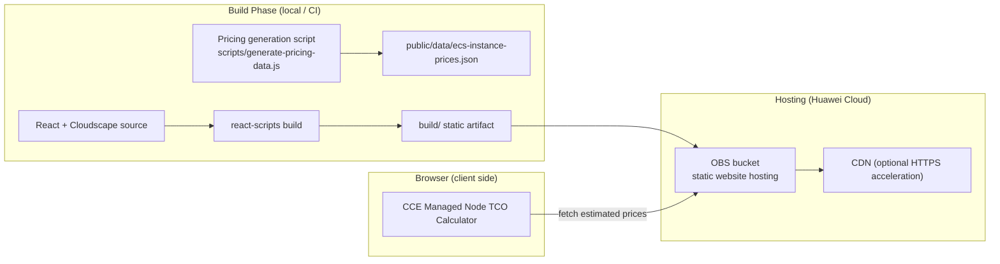

# CCE Managed Node TCO Calculator


> A pure front-end calculator that compares the Total Cost of Ownership (TCO) of "self-managed Elastic Cloud Server (ECS) + Auto Scaling group" versus "Cloud Container Engine (CCE) managed nodes (node pool)".

## 2. Introduction / Overview

The CCE Managed Node TCO Calculator helps platform engineers and architects quantify the cost difference of adopting **CCE managed nodes** versus **self-managed standard ECS**. It simultaneously measures infrastructure cost (ECS instance fee + CCE managed node service fee) and platform-engineering labor cost (manual management vs. automated managed service), and outputs the monthly savings plus additional benefits from bin-packing efficiency improvements. All calculations run locally in the browser — **no backend, no cloud runtime resources required**.

Intended audience: container platform teams, FinOps (cost optimization) engineers, and architecture review committees.

## 3. Table of Contents

- [1. Title and Badges](#cce-managed-node-tco-calculator)
- [2. Introduction / Overview](#2-introduction--overview)
- [3. Table of Contents](#3-table-of-contents)
- [4. Architecture Diagram](#4-architecture-diagram)
- [5. Highlights](#5-highlights)
- [6. Cloud Services Involved](#6-cloud-services-involved)
- [7. Prerequisites](#7-prerequisites)
- [8. Quick Start / One-Click Deploy](#8-quick-start--one-click-deploy)
- [9. Step-by-Step Deployment](#9-step-by-step-deployment)
- [10. Usage / Verification](#10-usage--verification)
- [11. Cleanup](#11-cleanup)
- [12. Detailed Description](#12-detailed-description)
- [13. Dependencies and Acknowledgements](#13-dependencies-and-acknowledgements)
- [14. FAQ / Troubleshooting](#14-faq--troubleshooting)
- [15. Contributing](#15-contributing)
- [16. License](#16-license)
- [17. Submitter](#17-submitter)

## 4. Architecture Diagram



The application is a pure static single-page app: the build artifact is hosted on OBS static website hosting; once loaded in the browser, all TCO calculations run locally and only `fetch` the same-origin pricing JSON on demand.

## 5. Highlights

- **Pure front-end, zero backend**: All calculations run locally in the browser; no functions / databases / container clusters are created, so it incurs no runtime cost by itself.
- **Two infrastructure modes compared**: Self-managed standard ECS + Auto Scaling group vs. CCE managed nodes (node pool).
- **Broad specification coverage**: 16 regions × 25 instance families (general-purpose / compute / memory / storage / GPU).
- **Dual pricing sources**: Local estimated prices by default (base price + regional multiplier, ~95% accurate), with optional BSS pricing API integration (credentials via environment variables only).
- **Multi-currency support**: 10 currencies + configurable exchange rates (incl. CNY).
- **Configurable assumptions**: Managed service fee rate (default 8%), platform engineer hourly rate, and per-instance management hours are all adjustable.
- **PDF export**: One-click export of a cost analysis report with dual-currency breakdown.

## 6. Cloud Services Involved

| Service | Purpose |
|---------|---------|
| Object Storage Service (OBS) | Static site hosting (bucket + static website + public-read policy) |
| Content Delivery Network (CDN) | Optional, provides HTTPS acceleration |

## 7. Prerequisites

- A Huawei Cloud account with permissions to create OBS buckets and configure static website hosting (CDN administrator permission required when enabling CDN).
- Local Node.js 18+ and npm.
- (Optional) The OBS command-line tool `obsutil`, used to upload `build/`.
- (Optional) Terraform 1.5+ and the `huaweicloud` Provider, used to create the hosting bucket as IaC.
- Default region: `cn-north-4` (CN North-Beijing4).

## 8. Quick Start / One-Click Deploy

```bash
# 1. Install dependencies and build (expected: build/ directory generated, no compile errors)
npm install
npm run build

# 2. Create the static hosting bucket with Terraform (expected: validate passes, apply outputs website_endpoint)
cd infra && terraform init -backend=false && terraform validate && terraform apply

# 3. Upload the artifact to the bucket (replace <bucket-name> with the actual bucket name)
obsutil cp -r ../build obs://<bucket-name> -f -flat
```

Open the address given by `terraform output website_endpoint` in a browser to start using it.

## 9. Step-by-Step Deployment

```bash
# Step 1: Get the code and install dependencies (expected: node_modules generated, no errors)
npm install

# Step 2: Build (expected: build/ produced, react-scripts with zero errors)
npm run build

# Step 3: Create the static hosting bucket (expected: validate passes)
cd infra
terraform init -backend=false
terraform validate          # expected: Success! The configuration is valid.
terraform plan
terraform apply             # expected: creates OBS bucket and enables static website + public-read policy

# Step 4: Upload the static artifact (expected: build/ contents synced to bucket root)
obsutil cp -r ../build obs://<bucket-name> -f -flat

# Step 5: Verify access (expected: returns site HTML containing the title "CCE Managed Node TCO Calculator")
curl -s "https://<bucket-name>.obs-website.cn-north-4.myhuaweicloud.com" | head -n 5
```

## 10. Usage / Verification

```bash
# Local development preview (expected: http://localhost:3000 opens the calculator)
npm start
```

Minimal usage example:

1. Select the currency (default USD).
2. Select region `cn-north-4` and flavor `s6.large`.
3. Adjust the monthly usage hours (default 730) and the CCE managed node service fee (default 8%).
4. Click "Calculate Cost" and confirm the following appear in the result area:
   - Elastic Cloud Server (ECS) cost
   - CCE managed node service fee
   - Savings percentage and platform-engineering labor savings
5. Switch currency (e.g., CNY) to confirm the amount converts with the exchange rate; click "Export PDF" to confirm the report is downloadable.

Verification success criteria: the title is "CCE Managed Node TCO Calculator", calculation results update in real time with parameters, and PDF export works.

## 11. Cleanup

```bash
# Delete uploaded objects to avoid ongoing storage charges
obsutil rm obs://<bucket-name> -r -f

# Destroy the bucket and policy created by Terraform
cd infra && terraform destroy
```

> Static hosting itself incurs no ongoing compute charges; once objects and the bucket are cleaned up, no further OBS fees are generated. If CDN was enabled, also disable and delete the acceleration domain in the CDN console.

## 12. Detailed Description

### 12.1 Cost Model

- **Infrastructure cost**: Self-managed standard ECS = ECS on-demand instance fee; CCE managed nodes = ECS instance fee + node managed service fee (default 8%, configurable).
- **Labor cost**: Self-managed standard ECS = 2 platform-engineering hours per instance per month; CCE managed nodes = 0.5 hour per instance per month (node provisioning / patching / lifecycle taken over by CCE).
- **Savings**: The monthly total-cost difference and percentage of managed nodes versus standard self-managed, plus additional savings from bin-packing efficiency improvements.

### 12.2 Pricing Data

- Default data: `public/data/ecs-instance-prices.json`, generated by `scripts/generate-pricing-data.js` based on base price + regional multiplier (~95% accurate), shipped with the package and available offline.
- Accurate pricing (optional): `scripts/fetch-huaweicloud-pricing.js` reserves the BSS pricing API integration skeleton (SDK-HMAC-SHA256 signing); it only calls the real API when the environment variables `HW_ACCESS_KEY` / `HW_SECRET_KEY` are configured, and automatically falls back to local estimates when not configured. Credentials are never written to disk or to any deliverable.

### 12.3 Configuration Items

| Config | Location | Description |
|--------|----------|-------------|
| Region | `src/data/options.js` → `regions` | 16 Huawei Cloud regions |
| Instance family | `src/data/options.js` → `instanceFamiliesByCategory` | General / Compute / Memory / Storage / GPU |
| Managed fee rate | `src/data/assumptions.js` → `managedNodeServiceFeePercentage` | Default 0.08 |
| Exchange rate | `src/data/currencies.js` | 10 currencies, incl. CNY 6.81 |

### 12.4 Report Artifact

- The in-browser "Export PDF" generates a cost analysis report (with dual-currency breakdown, covering infrastructure / labor / comparison in three sections).

## 13. Dependencies and Acknowledgements

Main dependencies:

- React 18 / react-scripts 5 (Create React App)
- Cloudscape Design System (`@cloudscape-design/components`, `@cloudscape-design/global-styles`)
- jsPDF + jspdf-autotable (PDF export)

Acknowledgements: This calculator is built on the container-infrastructure TCO comparison methodology; the UI uses Huawei Cloud's official design system, Cloudscape Design.

## 14. FAQ / Troubleshooting

- **Prices inaccurate?** The default data is estimate-level (~95%). For production accuracy, run `npm run fetch-pricing` (requires BSS pricing credentials) and republish, or run `npm run update-pricing` to refresh the local estimates.
- **Region / flavor not found?** Add or remove entries in `src/data/options.js` then rebuild.
- **Static website 403?** Confirm the bucket has static website hosting enabled and the bucket policy allows anonymous `GetObject` (configured by `terraform apply`).
- **CDN needs HTTPS?** Put a CDN in front of the OBS static website, set the origin to the OBS static website address, and configure the CNAME.
- **Build warnings?** This repo uses `react-scripts@5.0.1` (eslint 8.x is no longer updated but still usable); it can be migrated to Vite if desired.

## 15. Contributing

Issues and Pull Requests are welcome. When adding new instance families / regions, please also update `scripts/generate-pricing-data.js` and `src/data/options.js` and regenerate the pricing data.

## 16. License

This project is released under the **MIT-0** license. See [LICENSE](./LICENSE) for details.

## 17. Submitter

- Submitter: zhangcheng123321
