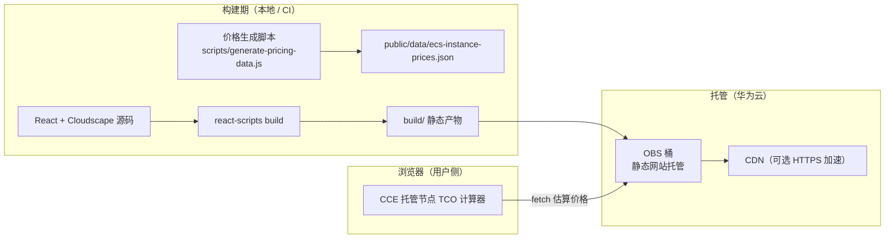

# CCE 托管节点 TCO 计算器


> 对比「标准弹性云服务器（ECS）自建 + 弹性伸缩组」与「云容器引擎（CCE）托管节点（节点池）」的总拥有成本（TCO）的纯前端计算器。

## 2. 简介 / 概述

CCE 托管节点 TCO 计算器帮助平台工程师与架构师量化采用 **CCE 托管节点** 相对 **标准 ECS 自建** 的成本差异。它同时测算基础设施成本（ECS 实例费 + CCE 托管节点服务费）与平台工程人力成本（手动管理 vs 自动化托管），并给出月度节省与装箱利用率提升带来的额外收益。所有计算均在浏览器本地完成，**无需后端、无需任何云端运行时资源**。

适用对象：容器平台团队、成本优化（FinOps）工程师、架构评审委员。

## 3. 目录

- [1. 标题与徽章](#cce-托管节点-tco-计算器)
- [2. 简介 / 概述](#2-简介--概述)
- [3. 目录](#3-目录)
- [4. 架构图](#4-架构图)
- [5. 方案亮点](#5-方案亮点)
- [6. 涉及云服务](#6-涉及云服务)
- [7. 前置条件](#7-前置条件)
- [8. 快速开始 / 一键部署](#8-快速开始--一键部署)
- [9. 分步部署](#9-分步部署)
- [10. 使用方法 / 验证](#10-使用方法--验证)
- [11. 清理资源](#11-清理资源)
- [12. 详细说明](#12-详细说明)
- [13. 依赖与致谢](#13-依赖与致谢)
- [14. FAQ / 故障排除](#14-faq--故障排除)
- [15. 贡献指南](#15-贡献指南)
- [16. 许可证](#16-许可证)
- [17. 提交者](#17-提交者)

## 4. 架构图



应用为纯静态单页应用：构建产物托管于 OBS 静态网站，浏览器加载后本地完成全部 TCO 计算，仅按需 `fetch` 同源价格 JSON。

## 5. 方案亮点

- **纯前端、零后端**：所有计算在浏览器本地完成，不创建函数 / 数据库 / 容器集群，本身零运行成本。
- **两种基础设施形态对比**：标准 ECS 自建 + 弹性伸缩组 vs CCE 托管节点（节点池）。
- **广泛规格覆盖**：16 区域 × 25 规格族（通用型 / 计算型 / 内存型 / 存储型 / GPU）。
- **双价格来源**：默认本地估算价格（基准价 + 区域乘数，约 95% 准确），可选 BSS 询价 API 接入（凭据仅环境变量）。
- **多币种支持**：10 种货币 + 可配置汇率（含 CNY）。
- **可配置假设**：托管费率（默认 8%）、平台工程师时薪、每实例管理工时均可调整。
- **PDF 导出**：一键导出含双币种明细的成本分析报告。

## 6. 涉及云服务

| 服务 | 用途 |
|------|------|
| 对象存储 OBS | 静态站点托管（桶 + 静态网站 + 公共读策略） |
| 内容分发网络 CDN | 可选，提供 HTTPS 加速 |


## 7. 前置条件

- 华为云账号，具备 OBS 创建与静态网站配置权限（启用 CDN 时需 CDN 管理员权限）。
- 本地 Node.js 18+ 与 npm。
- （可选）OBS 命令行工具 `obsutil`，用于上传 `build/`。
- （可选）Terraform 1.5+ 与 `huaweicloud` Provider，用于以 IaC 创建托管桶。
- 默认区域：`cn-north-4`（华北-北京四）。

## 8. 快速开始 / 一键部署

```bash
# 1. 安装依赖并构建（预期：生成 build/ 目录，无编译错误）
npm install
npm run build

# 2. 以 Terraform 创建静态托管桶（预期：validate 通过，apply 后输出 website_endpoint）
cd infra && terraform init -backend=false && terraform validate && terraform apply

# 3. 上传产物到桶（将 <桶名> 替换为实际桶名）
obsutil cp -r ../build obs://<桶名> -f -flat
```

浏览器打开 `terraform output website_endpoint` 给出的地址即可使用。

## 9. 分步部署

```bash
# 步骤 1：获取代码并安装依赖（预期：node_modules 生成，无报错）
npm install

# 步骤 2：构建（预期：产出 build/，react-scripts 零错误）
npm run build

# 步骤 3：创建静态托管桶（预期：validate 通过）
cd infra
terraform init -backend=false
terraform validate          # 预期：Success! The configuration is valid.
terraform plan
terraform apply             # 预期：创建 OBS 桶并开启静态网站 + 公共读策略

# 步骤 4：上传静态产物（预期：build/ 内容同步到桶根目录）
obsutil cp -r ../build obs://<桶名> -f -flat

# 步骤 5：验证访问（预期：返回站点 HTML，含「CCE 托管节点 TCO 计算器」标题）
curl -s "https://<桶名>.obs-website.cn-north-4.myhuaweicloud.com" | head -n 5
```

## 10. 使用方法 / 验证

```bash
# 本地开发预览（预期：http://localhost:3000 打开计算器）
npm start
```

最简使用示例：

1. 选择币种（默认 USD）。
2. 选择区域 `cn-north-4` 与规格 `s6.large`。
3. 调整每月使用时长（默认 730 小时）与 CCE 托管节点服务费（默认 8%）。
4. 点击「计算成本」，确认结果区出现：
   - 弹性云服务器（ECS）成本
   - CCE 托管节点服务费
   - 节省百分比与平台工程工时节省
5. 切换币种（如 CNY）确认金额随汇率换算；点击「导出 PDF」确认报告可下载。

验证成功标志：标题为「CCE 托管节点 TCO 计算器」，计算结果随参数实时更新，PDF 可导出。

## 11. 清理资源

```bash
# 删除已上传的对象，避免持续存储计费
obsutil rm obs://<桶名> -r -f

# 销毁 Terraform 创建的桶与策略
cd infra && terraform destroy
```

> 静态托管本身无持续计算计费；清理对象与桶后不再产生 OBS 费用。若启用过 CDN，请同步在 CDN 控制台停用并删除加速域名。

## 12. 详细说明

### 12.1 成本测算模型

- **基础设施成本**：标准 ECS 自建 = ECS 按需实例费；CCE 托管节点 = ECS 实例费 + 节点托管服务费（默认 8%，可配置）。
- **人力成本**：标准 ECS 自建按每实例每月 2 小时平台工程工时；CCE 托管节点按每实例每月 0.5 小时（节点供给 / 补丁 / 生命周期由 CCE 接管）。
- **节省**：托管节点相对标准自建的月度总成本差与百分比，并叠加装箱（bin-packing）利用率提升的额外节省。

### 12.2 价格数据

- 默认数据：`public/data/ecs-instance-prices.json`，由 `scripts/generate-pricing-data.js` 基于基准价 + 区域乘数生成（约 95% 准确），随包发布、离线可用。
- 精准询价（可选）：`scripts/fetch-huaweicloud-pricing.js` 预留 BSS 询价 API 接入骨架（SDK-HMAC-SHA256 签名）；仅当配置环境变量 `HW_ACCESS_KEY` / `HW_SECRET_KEY` 时调用真实 API，未配置自动回退本地估算。凭据不落盘、不写入任何产物。

### 12.3 配置项

| 配置 | 位置 | 说明 |
|------|------|------|
| 区域 | `src/data/options.js` → `regions` | 16 个华为云区域 |
| 规格族 | `src/data/options.js` → `instanceFamiliesByCategory` | 通用 / 计算 / 内存 / 存储 / GPU |
| 托管费率 | `src/data/assumptions.js` → `managedNodeServiceFeePercentage` | 默认 0.08 |
| 汇率 | `src/data/currencies.js` | 10 币种，含 CNY 6.81 |

### 12.4 报告产物

- 浏览器内「导出 PDF」生成成本分析报告（含双币种明细、基础设施 / 人力 / 对比三部分）。

## 13. 依赖与致谢

主要依赖：

- React 18 / react-scripts 5（Create React App）
- Cloudscape Design System（`@cloudscape-design/components`、`@cloudscape-design/global-styles`）
- jsPDF + jspdf-autotable（PDF 导出）

致谢：本计算器基于容器基础设施 TCO 对比方法论构建，UI 采用华为云官方设计系统 Cloudscape Design。

## 14. FAQ / 故障排除

- **价格不准？** 默认数据为估算级（约 95%）。生产精度请运行 `npm run fetch-pricing`（需配置 BSS 询价凭据）后重新发布，或运行 `npm run update-pricing` 刷新本地估算。
- **区域 / 规格找不到？** 在 `src/data/options.js` 增删条目后重新构建。
- **静态网站 403？** 确认桶已开启静态网站托管且桶策略允许匿名 `GetObject`（`terraform apply` 已配置）。
- **CDN 需要 HTTPS？** 在 OBS 静态网站前接入 CDN，源站填 OBS 静态网站地址并配置 CNAME。
- **构建告警？** 本仓使用 `react-scripts@5.0.1`（eslint 8.x 不再更新但可用）；如需可迁移至 Vite。

## 15. 贡献指南

欢迎提交 Issue 与 Pull Request。新增规格族 / 区域请同步更新 `scripts/generate-pricing-data.js` 与 `src/data/options.js` 并重新生成价格数据。

## 16. 许可证

本项目基于 **MIT-0** 许可证发布。详见 [LICENSE](./LICENSE)。

## 17. 提交者

- 提交者： zhangcheng123321
