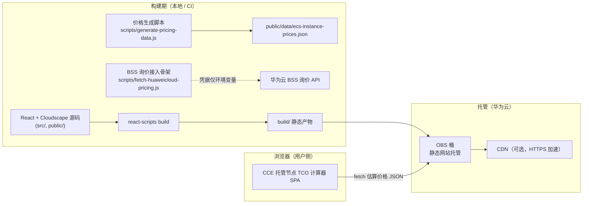

# 架构说明：CCE 托管节点 TCO 计算器

## 1. 总体架构

CCE 托管节点 TCO 计算器是一个**纯前端、零后端**的总拥有成本（TCO）对比工具，用于帮助用户在华为云上对比两种容器基础设施形态的成本：

- **标准弹性云服务器（ECS）自建 + 弹性伸缩组（ASG）**：用户自行管理 ECS 实例、镜像、补丁、伸缩策略与监控。
- **云容器引擎（CCE）托管节点（节点池）**：由 CCE 接管节点的供给、补丁与生命周期，按节点收取托管服务费。

应用本身不涉及任何云端运行时资源，所有计算均在浏览器本地完成。部署形态是静态站点，可托管于对象存储（OBS）静态网站，亦可接入内容分发网络（CDN）提供 HTTPS 加速。

## 2. 关键组件

| 组件 | 说明 | 华为云对应服务 |
|------|------|-----------|
| 前端应用 | React 18 + Cloudscape Design System 单页应用，所有 TCO 计算在浏览器本地完成 | — |
| 估算价格数据 | `public/data/ecs-instance-prices.json`，由生成脚本基于基准价 + 区域乘数产出（约 95% 准确） | — |
| 询价接入骨架 | `scripts/fetch-huaweicloud-pricing.js`，封装 BSS 询价 API 的 SDK-HMAC-SHA256 签名；未配置凭据时回退到本地估算 | 华为云 BSS / 价格查询 |
| 静态托管 | OBS 桶开启静态网站托管 + 公共读桶策略；CDN 可选 | 对象存储 OBS、内容分发网络 CDN |

## 3. 数据流

1. 构建阶段：`scripts/generate-pricing-data.js` 产出 `ecs-instance-prices.json`（16 区域 × 25 规格族），随 `react-scripts build` 一并打包进 `build/`。
2. 运行阶段：浏览器加载 SPA 后，通过 `fetch('/data/ecs-instance-prices.json')` 取得估算价格；当用户调整区域、规格、数量、托管费率、平台工程师时薪等参数后，全部计算在本地完成。
3. 价格刷新（可选）：`scripts/fetch-huaweicloud-pricing.js` 可作为定时任务从 BSS 询价 API 拉取更精准的按需价，覆盖 `ecs-instance-prices.json`。该脚本仅在配置了 `HW_ACCESS_KEY` / `HW_SECRET_KEY` 环境变量时调用真实 API，凭据不落盘、不写入任何产物。

## 4. 成本测算模型

计算器对比两类成本：

- **基础设施成本**：ECS 按需实例费（标准自建）vs ECS 实例费 + CCE 托管节点服务费（托管节点，默认 8%，可配置）。
- **人力成本**：标准 ECS 自建按每实例每月 2 小时平台工程工时估算；CCE 托管节点按每实例每月 0.5 小时估算（节点供给/补丁/生命周期由 CCE 接管）。
- **节省**：托管节点相对标准自建的月度总成本差与百分比，并给出装箱（bin-packing）利用率提升带来的额外节省。

> 说明：本实践将「节点托管」概念映射为华为云 **CCE 托管节点（节点池）**，将实例按需计费映射为华为云 **ECS 按需实例费**，托管费率由 12% 调整为可配置的 8%。映射与降级决策详见 `others/architecture-adaptation.md` 与 `others/service-mapping.md`。

## 5. 费用与资源

- 应用运行期**不创建任何云端计算/数据库/函数资源**，本身零运行成本。
- 静态托管仅占用 OBS 标准存储与出流量（按量计费，成本极低）；若启用 CDN 则按流量与请求数计费。
- 部署与清理命令见 `deployment-guide.md` 与 `README.md`。
